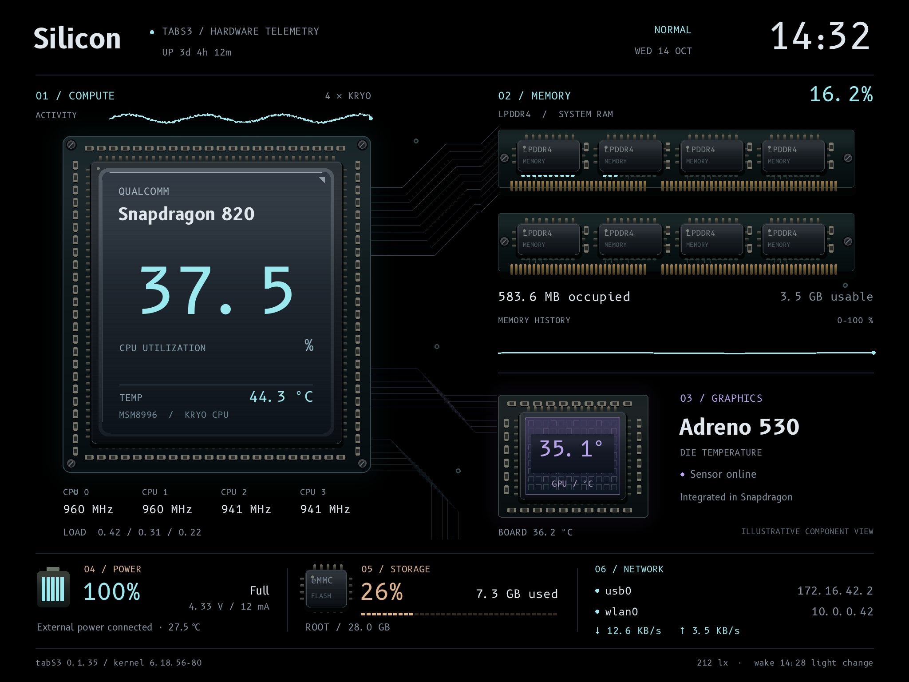

# TabS3 Linux

**Native Linux for the Samsung Galaxy Tab S3.**

An experimental Linux port for **SM-T825, board revision 5**, built around
Debian 13, a patched Linux kernel, and a dashboard that draws directly to the
tablet's 2048 × 1536 panel. No browser or desktop session is needed for the
dashboard.



*Silicon — the native AMOLED dashboard, shown with sample data.*

**[Installation](docs/installation.md) · [Accounts & passwords](docs/accounts.md) ·
[User guide](docs/user-guide.md) · [Hardware status](docs/hardware-status.md) ·
[Build from source](docs/building.md) · [Screenshots](docs/screenshots.md)**

## What is here

- **Native Debian:** internal-storage boot, APT, systemd, SSH over USB or Wi-Fi.
- **Five AMOLED dashboards:** Silicon, Observatory, Folio, Terminal, and Original;
  CPU, RAM, temperatures, battery, storage, network, and history graphs.
- **Tablet hardware support:** panel and brightness, touchscreen and S Pen,
  hardware buttons, Wi-Fi, Bluetooth, storage, charging, cameras, and sensors.
  See the status table for the limits of each test.
- **Appliance tools:** charge window, low-battery shutdown guard, health recorder,
  panel idle/wake, pixel shifting, and private off-device backups.
- **Development tools:** pinned source inputs, container builds, boot-image
  validation, driver tests, and a separate recovery environment.

## Read before installing

This is a **source release for experienced Linux/device-port developers**, not
a production-qualified distribution or a universal Tab S3 installer. Only the
SM-T825 LTE rev05 has been tested. SM-T820, SM-T827, and other revisions are not
validated. Initial installation erases Android user data and replaces its boot
path. A working recovery and your own backups are prerequisites.

There is **no shared password, preconfigured login image, or bundled Samsung
firmware**. You choose a console password and supply your SSH public key during
the build. The initial account is `dev`, with passwordless sudo. Users can choose
SSH keys or enable password login; root SSH is disabled by default in installed
Debian. [Set up your accounts and SSH login](docs/accounts.md).

The last recorded installed baseline is kernel package `6.18.56-80`, base
`0.1.35`, dashboard `0.1.9` (2026-11-05). This source snapshot builds candidate
`6.18.56-81~drivers2`: its video modules passed bounded hardware tests, but the
complete candidate has **not** passed a fresh boot or production soak. Mobile
data, GNSS fixes, fingerprint support, reliable suspend, and some audio/USB
qualification remain open. [Details and evidence](docs/hardware-status.md).

## Try the dashboard design on your computer

No tablet access is needed for a preview. With Python and Pillow installed:

```sh
git clone --recurse-submodules https://github.com/victorQ8/tabs3-linux.git
cd tabs3-linux
python3 tools/dashboard-preview
```

Open `work/dashboard-designs/index.html`. The gallery includes normal, warning,
missing-sensor, battery-resting, and charge-reduction states. B612 and DejaVu
fonts give the same appearance as the tablet; see [building](docs/building.md).

## Documentation

| Start here | Contents |
| --- | --- |
| [Installation](docs/installation.md) | Model checks, backups, recovery, RAM tests, internal install, first boot |
| [Accounts & passwords](docs/accounts.md) | SSH keys, `dev`, console password, new administrator, sudo |
| [User guide](docs/user-guide.md) | Network, themes, power, updates, logs, troubleshooting |
| [Screenshots](docs/screenshots.md) | All five themes and rendering instructions |
| [Hardware status](docs/hardware-status.md) | What works, what was measured, and what remains unfinished |
| [Build guide](docs/building.md) | Dependencies, source pins, packages, personalized images, tests |
| [Recovery & updates](docs/maintenance.md) | Backups, kernel/image consistency, recovery and rollback |
| [Contributing](CONTRIBUTING.md) | Test scope, patches, issue reports, and private data |
| [Security](SECURITY.md) | Private vulnerability reporting, support scope, and authentication defaults |
| [Technical records](docs/hardware-sm-t825.md) | Detailed driver notes and dated validation evidence |

Earlier bring-up notes are retained in [HISTORY.md](HISTORY.md). They describe
the system at the date of each experiment, not necessarily today's behavior.
Emulation and game collections are not part of this release.

## Credits and licenses

Most of the project-specific development was carried out by **OpenAI Codex**
and **Anthropic Claude**. Their contributions span kernel and driver work,
Debian integration, recovery tools, dashboard design, testing, and documentation.

Built on [Debian](https://www.debian.org/), [Linux](https://kernel.org/),
the [Tab S3 community port](https://github.com/wh1ter0z3/gts3lwifi-mainline),
[msm8996-mainline](https://gitlab.com/msm8996-mainline/linux),
[lk2nd](https://github.com/msm8916-mainline/lk2nd), and
[LVGL](https://github.com/lvgl/lvgl). Author attribution is retained
in carried patches and third-party files.

Original project files use the [MIT license](LICENSE) unless otherwise marked.
Linux/Samsung-derived files retain their GPL notices; see
[LICENSES/GPL-2.0-only.txt](LICENSES/GPL-2.0-only.txt) and
[credits](docs/credits.md). Samsung firmware, calibration, credentials, ROMs,
and personalized disk/boot images are not distributed.
