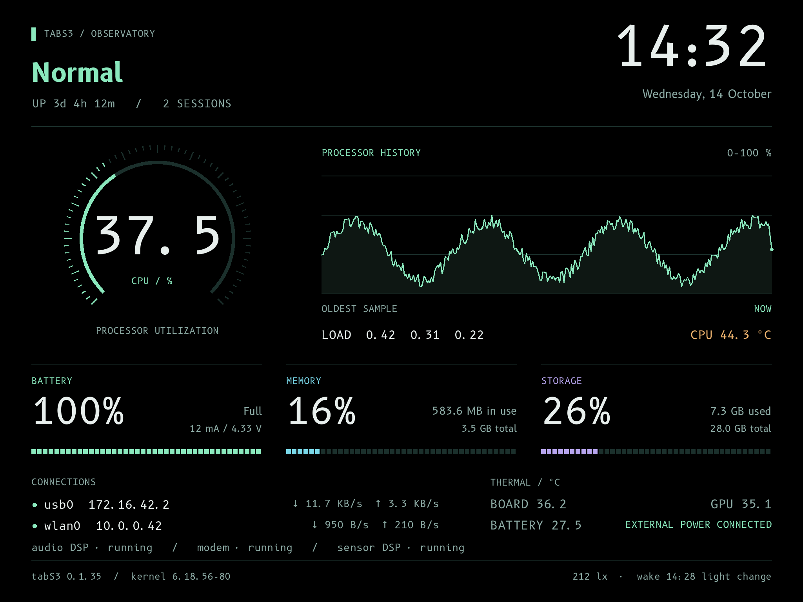
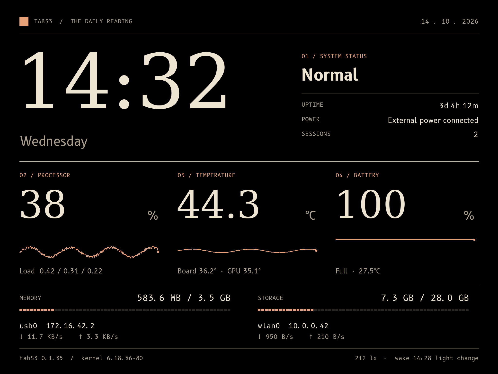
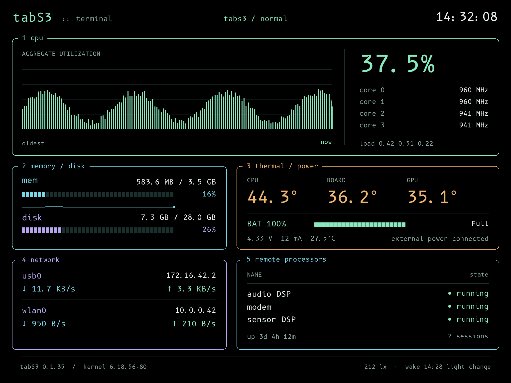
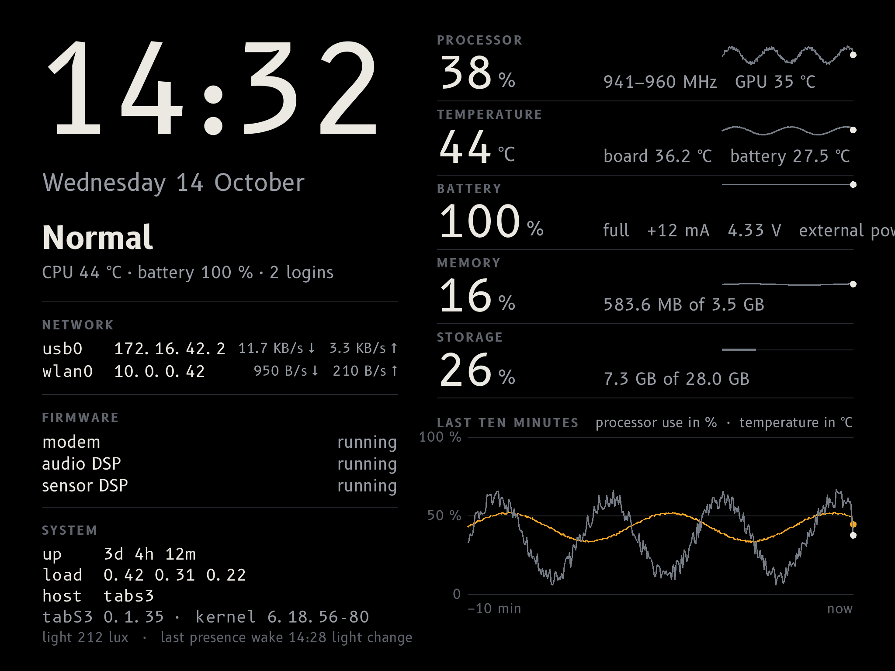
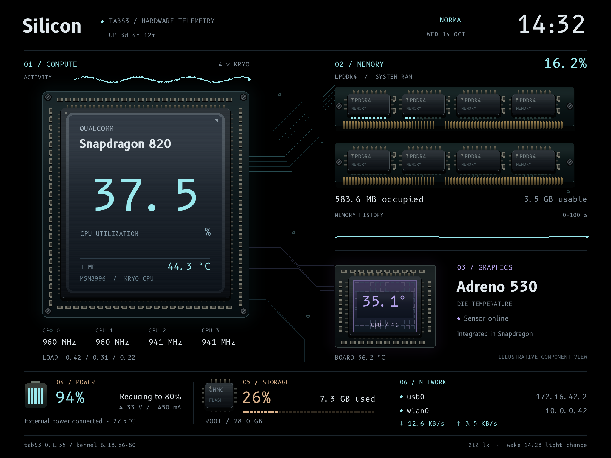

# Dashboard screenshots

These are **actual dashboard renders with synthetic readings**, not photographs
or current telemetry from a device. Each image is 2048 × 1536. Render them
yourself with `python3 tools/dashboard-preview`; see [building](building.md)
for fonts and dependencies.

## Silicon

`sudo tabs3-dashboard-theme silicon`

A hardware-inspired view of CPU activity, memory use, GPU temperature, power,
storage, and network status.

## Observatory

`sudo tabs3-dashboard-theme observatory`

## Folio

`sudo tabs3-dashboard-theme folio`

## Terminal

`sudo tabs3-dashboard-theme terminal`

## Original

`sudo tabs3-dashboard-theme original`

Original remains the package default; a saved theme survives upgrades.

## Charge management state

External power can be connected while the keeper deliberately lowers a full
battery toward its configured target. See [charging](user-guide.md#charging-and-battery-care)
and [dashboard implementation](dashboard.md) for details.
